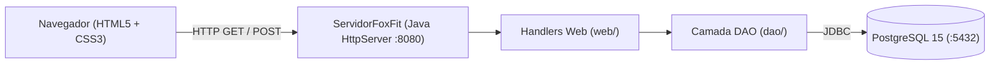

#  FoxFit — Sistema de Gestão de Academia

Sistema web para gestão operacional, administrativa e financeira de academias.


---    

##  Tecnologias

- **Back-end:** Java 21, `com.sun.net.httpserver.HttpServer` nativo (sem frameworks externos) e JDBC (`postgresql-42.7.14.jar`)
- **Banco de Dados:** PostgreSQL 15 containerizado com Docker Compose
- **Front-end:** HTML5 Semântico e CSS3 Puro com variáveis reutilizáveis (`:root`), CSS Grid e Flexbox

---

##  Sumário

- [Módulos do Sistema](#-módulos-do-sistema)
- [Arquitetura e Estrutura de Pastas](#-arquitetura-e-estrutura-de-pastas)
- [Pré-requisitos](#-pré-requisitos)
- [Como Executar o Projeto](#-como-executar-o-projeto)
- [Rotas do Servidor Web](#-rotas-do-servidor-web)
- [Banco de Dados (PostgreSQL)](#-banco-de-dados-postgresql)

---

##  Módulos do Sistema

| Módulo | Tela | Status (Back-end) | Funcionalidades |
| :--- | :--- | :---: | :--- |
| **Dashboard** | `dashboard.html` | ✅ Concluído | KPIs consolidados (alunos ativos, matrículas no mês, receita mensal, taxa de adimplência) e tabela de matrículas recentes. |
| **Planos de Assinatura** | `planos.html` | ✅ Concluído | Vitrine dinâmica de planos ativos, cadastro, edição, inativação e exclusão com cálculo automático do valor total do contrato. |
| **Fluxo Financeiro** | `financeiro.html` | ✅ Concluído | Indicadores financeiros (recebido, pendente e em atraso), filtros por status, competência (`YYYY-MM`) e busca, além da baixa de pagamentos. |
| **Gestão de Alunos** | `alunos.html` | ✅ Concluído | Cadastro, listagem, filtro por nome/CPF/status, edição e exclusão de alunos. |
| **Professores** | `professores.html` | 🚧 Em desenvolvimento | Front-end concluído (CREF, especialidade e turno); integração Java/DAO em andamento. |
| **Matrículas** | `matriculas.html` | 🚧 Em desenvolvimento | Front-end concluído (vínculo aluno-plano, vigência e renovação); integração Java/DAO em andamento. |
| **Meu Perfil e Acesso** | `perfil.html`, `login.html` | ✅ Concluído | Edição de nome/e-mail, alteração segura de senha com validações, bloqueio de e-mail duplicado, autenticação com cookies/sessão e DAO integrado. |
| **Usuários e Cadastro** | `cadastro.html` | 🚧 Em desenvolvimento | Front-end concluído (RBAC); cadastro e permissões de operadores em andamento. |

---

## Arquitetura e Estrutura de Pastas

O servidor Java (`ServidorFoxFit`) entrega os arquivos estáticos de `frontend/` e renderiza dinamicamente as páginas integradas ao PostgreSQL via JDBC:



### Estrutura do Repositório

```text
FoxFit/
├── backend/                       
│   ├── lib/
│   │   └── postgresql-42.7.14.jar    # Driver JDBC oficial do PostgreSQL
│   └── src/main/java/br/uepa/foxfit/
│       ├── database/                 # Conexão JDBC via variáveis de ambiente (Conexao.java)
│       ├── model/                    # Modelos (Aluno, Plano, Mensalidade, ResumoDashboard...)
│       ├── dao/                      # Operações SQL (AlunoDAO, PlanoDAO, FinanceiroDAO, DashboardDAO)
│       └── web/                      # ServidorFoxFit, WebUtils e Handlers HTTP
│
├── frontend/                         # Interface web (HTML5 Semântico + CSS3 Puro)
│   ├── index.html                    # Entrada principal (redireciona para login.html)
│   ├── assets/
│   │   ├── css/style.css             # Folha de estilos com variáveis CSS (:root)
│   │   └── images/logofox.jpeg       # Logotipo oficial FOX FIT
│   └── pages/                        # Telas do sistema (dashboard, planos, financeiro, alunos, etc.)
│
├── database/
│   └── init.sql                      # Script SQL de criação das 6 tabelas e dados iniciais
│
├── .gitignore                        # Ignora artefatos compilados (out/) e arquivos de IDEs
├── docker-compose.yml                # Configuração local do PostgreSQL no Docker
└── README.md                         # Documentação do projeto
```

---

## Pré-requisitos

- **[JDK 21](https://adoptium.net/)** (ou superior)
- **[PostgreSQL 15](https://www.postgresql.org/)** (local ou via **[Docker Desktop](https://www.docker.com/products/docker-desktop/)**)
- **[Git](https://git-scm.com/)**

---

## ▶Como Executar o Projeto

### 1. Clonar o repositório
```bash
git clone https://github.com/nanagss/FoxFit.git
cd FoxFit
```

### 2. Definir a senha via variável de ambiente e subir o banco PostgreSQL
Por segurança, a senha do banco **não fica no código-fonte nem na documentação**. O `docker-compose.yml` e a classe `Conexao.java` leem diretamente a variável de ambiente `FOXFIT_DB_PASSWORD` (e opcionalmente `FOXFIT_DB_PORT`):

| Variável | Obrigatória | Descrição |
| :--- | :---: | :--- |
| `FOXFIT_DB_PASSWORD` | Sim | Senha do usuário `postgres` usada pelo Docker e por `Conexao.java` |
| `FOXFIT_DB_PORT` | Não | Porta do PostgreSQL (padrão: `5432`) |

Com o Docker Desktop em execução, defina a variável no terminal e suba o banco (que executa automaticamente `database/init.sql`):

- **Windows (PowerShell):**
  ```powershell
  $env:FOXFIT_DB_PASSWORD="<sua_senha_local>"
  docker compose up -d
  ```
- **Linux / macOS (Bash / Zsh):**
  ```bash
  export FOXFIT_DB_PASSWORD="<sua_senha_local>"
  docker compose up -d
  ```

*(Caso utilize PostgreSQL instalado diretamente na máquina, crie o banco `foxfit` e execute `database/init.sql`).*

### 3. Compilar e iniciar o servidor Java

#### Windows (PowerShell)
```powershell
# Compilar o back-end para a pasta out/
$arquivos = Get-ChildItem -Recurse -Filter *.java backend/src/main/java | ForEach-Object { $_.FullName }
javac -encoding UTF-8 -cp backend/lib/postgresql-42.7.14.jar -d out $arquivos

# Definir a variável de ambiente da senha e iniciar o servidor
$env:FOXFIT_DB_PASSWORD="<sua_senha_local>"
java -cp "out;backend/lib/postgresql-42.7.14.jar" br.uepa.foxfit.web.ServidorFoxFit
```

#### Linux / macOS (Bash / Zsh)
```bash
# Compilar o back-end para a pasta out/
javac -encoding UTF-8 -cp backend/lib/postgresql-42.7.14.jar -d out $(find backend/src/main/java -name "*.java")

# Definir a variável de ambiente da senha e iniciar o servidor
export FOXFIT_DB_PASSWORD="<sua_senha_local>"
java -cp "out:backend/lib/postgresql-42.7.14.jar" br.uepa.foxfit.web.ServidorFoxFit
```

#### Pelo IntelliJ IDEA (ou outra IDE Java)
1. Abra a pasta do projeto na IDE.
2. Adicione `backend/lib/postgresql-42.7.14.jar` às dependências do módulo.
3. Configure `FOXFIT_DB_PASSWORD` nas variáveis de ambiente da execução de `br.uepa.foxfit.web.ServidorFoxFit`.
4. Execute a classe `ServidorFoxFit`.

### 4. Acessar no navegador
Com o servidor ativo (`Servidor FoxFit iniciado!`), acesse:
- **Entrada / Login:** `http://127.0.0.1:8080`
- **Dashboard:** `http://127.0.0.1:8080/pages/dashboard.html`
- **Planos de Assinatura:** `http://127.0.0.1:8080/pages/planos.html`
- **Fluxo Financeiro:** `http://127.0.0.1:8080/pages/financeiro.html`
- **Gestão de Alunos:** `http://127.0.0.1:8080/pages/alunos.html`

> **Sobre o acesso inicial (`login.html`):** Enquanto o módulo de autenticação na tabela `usuarios` está em desenvolvimento, o acesso pelo login é **direto/visual** — basta informar qualquer e-mail em formato válido e uma senha com 6+ caracteres (ou acessar diretamente as URLs das telas acima).
>
> **Importante:** Sempre abra as páginas via `http://127.0.0.1:8080, pois o `ServidorFoxFit` é responsável por carregar os dados do PostgreSQL e processar os formulários.

---

## Rotas do Servidor Web

| Método | Rota | Responsabilidade |
| :---: | :--- | :--- |
| `GET` | `/pages/dashboard.html` | Renderiza os 4 KPIs consolidados e as 5 matrículas mais recentes. |
| `GET` | `/pages/planos.html` | Lista planos na vitrine e na tabela (`?editar=ID` e `?excluir=ID`). |
| `POST` | `/planos/cadastrar` | Cadastra novo plano gerando código automático (`#PLN-XX`). |
| `POST` | `/planos/atualizar` | Atualiza dados comerciais, benefícios e status de um plano. |
| `POST` | `/planos/excluir` | Remove um plano (bloqueia com `409` se houver matrículas vinculadas). |
| `GET` | `/pages/financeiro.html` | Exibe KPIs financeiros e tabela filtrável por status, competência e busca. |
| `POST` | `/financeiro/pagar` | Confirma o pagamento (`status = 'PAGO'`, `data_pagamento = CURRENT_DATE`). |
| `GET` | `/pages/alunos.html` | Renderiza a gestão de alunos com filtros, edição e exclusão. |
| `GET` | `/alunos/listar` | Retorna listagem textual de alunos cadastrados. |
| `POST` | `/alunos/cadastrar` | Cadastra novo aluno. |
| `POST` | `/alunos/atualizar` | Atualiza cadastro de aluno existente. |
| `POST` | `/alunos/excluir` | Remove aluno sem vínculos ativos. |
| `GET` | `/pages/perfil.html` | Renderiza a tela de Meu Perfil com dados do operador logado e banners de status. |
| `POST` | `/perfil/atualizar` | Atualiza os dados funcionais (nome e e-mail corporativo) do operador. |
| `POST` | `/perfil/alterar-senha` | Valida senha atual e atualiza a senha de acesso (mínimo de 8 caracteres). |

---

## Banco de Dados (PostgreSQL)

A conexão em `Conexao.java` aponta para `127.0.0.1` (porta padrão `5432`), banco `foxfit` e usuário `postgres`, lendo a senha exclusivamente da variável de ambiente `FOXFIT_DB_PASSWORD`.

O script `database/init.sql` cria automaticamente as 6 tabelas relacionais do sistema:
1. **`usuarios`** — Administradores (`ADMIN`) e operadores (`OPERADOR`).
2. **`alunos`** — Ficha cadastral, contato e status (`ATIVO` / `INATIVO`).
3. **`professores`** — Instrutores, CREF, especialidade e turno.
4. **`planos`** — Planos comerciais, duração em meses, valor mensal/total e benefícios.
5. **`matriculas`** — Contratos vinculando alunos aos planos, vigência e forma de pagamento.
6. **`mensalidades`** — Cobranças mensais, vencimento, data de pagamento e status (`PAGO`, `PENDENTE`, `ATRASADO`).